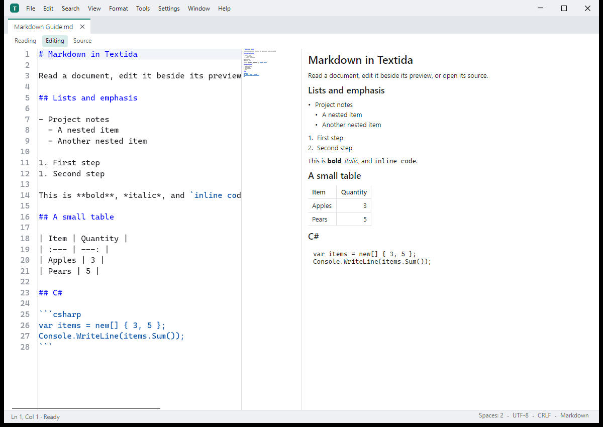

# Textida

[](https://github.com/nks-hub/textida/actions/workflows/release.yml)
[](https://github.com/nks-hub/textida/releases)
[](https://dotnet.microsoft.com/)
[](#požadavky)
[](LICENSE)

> Textový editor pro Windows, macOS a Linux. Dokument čte po stránkách, takže otevře i soubor větší než paměť RAM. Je napsaný v C# / .NET 10 a Avalonia 12. Testovací sestavení jsou na stránce [Releases](https://github.com/nks-hub/textida/releases).

**Jazyky:** [English](README.md) · Čeština · [Slovenčina](README.sk.md) · [Deutsch](README.de.md)



[Stránka produktu a snímky obrazovky](https://nks-hub.cz/reference/repo-textida)

Editor je nový program inspirovaný PSPadem. Nepoužívá kód, data ani zdroje PSPadu.

## Funkce

- 📄 **Dokumenty po stránkách** - z disku čte jen viditelné úseky a úpravy drží zvlášť, s funkcí zpět a ukládáním, které nezmění nedotčené bajty.
- 🔍 **Hledání a navigace** - hledání prostého textu i regulárních výrazů, které jde přerušit, a skok na řádek nebo na pozici v bajtech.
- 🔤 **Text a hex** - rozpoznání kódování, převod do zvoleného kódování, úpravy textu a hexadecimální pohled na tentýž dokument.
- 📝 **Markdown** - režim čtení, úprav a zdroje, vlastní náhled, úpravy tabulek a vygenerovaný obsah.
- 🧩 **Přibalené nástroje** - samostatné procesy pluginů pro formátování, statistiku textu, hashe a jazykové nástroje a k tomu server MCP.
- 📦 **Balíčky pro desktop** - instalátor a přenosný ZIP pro Windows, DMG a ZIP pro macOS a balíčky pro Linux. Vydaná sestavení NativeAOT mají runtime v sobě.

## Požadavky

- Windows 10 22H2 nebo novější (x64), nebo macOS 14 nebo novější (Apple silicon i Intel)
- Linux (zkušebně): Debian 12 nebo novější, nebo Ubuntu 22.04 nebo novější, na x64 nebo ARM64
- .NET SDK 10.0.402 (pevně v `global.json`) pro sestavení ze zdrojů; stažené balíčky NativeAOT nainstalovaný runtime .NET nepotřebují
- [ripgrep](https://github.com/BurntSushi/ripgrep) jen pro srovnávací měření hledání

## Instalace

Testovací sestavení jsou na stránce [Releases](https://github.com/nks-hub/textida/releases). Zatím nejsou podepsaná certifikátem vydavatele, takže Windows SmartScreen a macOS Gatekeeper při prvním spuštění varují.

- **Windows:** `TextidaSetup-<version>-win-x64.exe` instaluje pro aktuálního uživatele bez práv správce; ZIP je přenosná verze.
- **macOS:** `Textida-<version>-osx-arm64.dmg` (Apple silicon) nebo `-osx-x64.dmg` (Intel). Přetáhněte Textidu do složky Aplikace a poprvé ji otevřete pravým tlačítkem a volbou Otevřít.
- **Linux (zkušebně):** `textida_<version>_amd64.deb` pro x64 nebo `textida_<version>_arm64.deb` pro ARM64. Odpovídající archiv tar `linux-x64` nebo `linux-arm64` obsahuje `install.sh`, který instaluje do `~/.local` a potřebuje OpenSSL 3 a ICU z distribuce.

### Debian a Ubuntu (apt)

Balíčky z vydání jsou také v apt repozitáři NKS Hub, takže nové verze přinese `apt upgrade`. Repozitář má balíčky pro x64 (`amd64`) a ARM64 (`arm64`):

```bash
curl -fsSL https://repo.nks-hub.cz/public-key.gpg | sudo gpg --dearmor -o /usr/share/keyrings/nks-dev.gpg

sudo tee /etc/apt/sources.list.d/textida.sources > /dev/null <<'EOF'
Types: deb
URIs: https://repo.nks-hub.cz/textida/
Suites: stable
Components: main
Architectures: amd64 arm64
Signed-By: /usr/share/keyrings/nks-dev.gpg
EOF

sudo apt update
sudo apt install textida
```

Metadata repozitáře podepisuje `NKS Dev <dev@nks-hub.cz>`. Odinstaluje se příkazem `sudo apt remove textida`; nastavení v `~/.config` zůstane.

Sestavení ze zdrojů:

```bash
git clone https://github.com/nks-hub/textida.git
cd textida
dotnet build
dotnet test --filter "Category!=Perf"
```

Testy `Perf` měří čas a potřebují sestavení Release popsané v části [Vývoj](#vývoj).

## Použití

Na Windows spusťte `Textida.exe`, na macOS otevřete Textidu ze složky Aplikace a na Linuxu spusťte `textida`. Soubor otevřete z menu, přetažením do okna nebo cestou na příkazové řádce. Dokumenty Markdown mají režim čtení, úprav a zdroje.

### Měření výkonu

Vygenerujte sadu testovacích souborů a spusťte scénář:

```bash
dotnet run -c Release --project bench/NksHub.Textida.Bench -- corpus --corpus ./bench-data/corpus --results ./bench-data/results
dotnet run -c Release --project bench/NksHub.Textida.Bench -- a3 text-1GiB.log --corpus ./bench-data/corpus --results ./bench-data/results
```

Sada se soubory o velikosti 10 GiB a 50 GiB zabere asi 130 GB volného místa na disku. `bench/run-mac.sh` spustí velikostní profil pro macOS.

## Vývoj

```bash
dotnet build NksHub.Textida.sln
dotnet test NksHub.Textida.sln --filter "Category!=Perf"
DOTNET_TieredCompilation=0 dotnet test tests/NksHub.Textida.App.Tests -c Release --filter "Category=Perf"
```

Testy označené `Perf` běží v Release s vypnutou vrstvenou kompilací a vždy jen jedno testovací sestavení naráz (p95 psaní 33 ms). V PowerShellu nastavte `$env:DOTNET_TieredCompilation = "0"` a předponu s přiřazením z Bashe vynechte. Testy `Large` pracují s řídkým souborem o velikosti 4,5 GiB a trvají asi minutu.

Distribuci NativeAOT vytvoří jeden příkaz. Obsahuje editor, vestavěné pluginy v `plugins/<name>/` a `textida-mcp` v `mcp/`, bez symbolů (`-p:PublishSymbols=true` soubory `.pdb` ponechá). Kontrola AOT ověří rozložení souborů a spustí každý program:

```bash
dotnet publish src/NksHub.Textida.App -c Release -r win-x64 -o ./dist
dotnet publish tools/NksHub.Textida.AotCheck -c Release -r win-x64 -o ./aotcheck
./aotcheck/NksHub.Textida.AotCheck --publish ./dist
```

Z tohoto výstupu vzniká balíček pro Windows ve dvou podobách.

- `Textida-<version>-win-x64.zip` je přenosná podoba (rozbalit, spustit `Textida.exe`). `Install.cmd` v něm spustí `Setup.ps1`, skriptový instalátor pro jednoho uživatele bez voleb.
- `TextidaSetup-<version>-win-x64.exe` je instalátor s volbami: jeden soubor NativeAOT, který nese ZIP a nativní knihovny svého okna. Umí čtyři jazyky (nejdřív jazyk Windows, dá se přepnout), ukáže licenci MIT a zeptá se na složku instalace, zástupce v nabídce Start, zástupce na ploše, položku „Otevřít v Textidě“ v menu Průzkumníka, typy souborů nabízené v Otevřít pomocí a na to, jestli má Textidu na konci spustit. Nepotřebuje práva správce a PSPadu se nedotkne.

Instalátor ve výchozím stavu instaluje do `%LOCALAPPDATA%\Programs\Textida` a nechá tam svou kopii jako odinstalátor (`TextidaSetup.exe --uninstall`, příkaz, který spouští Aplikace a funkce). Odinstalátor odstraní soubory, zástupce, položku menu, přidružení a záznam v Aplikace a funkce. Nastavení v `%APPDATA%\Textida` ponechá, pokud není zaškrtnuto „Smazat i nastavení“. Instalátor spuštěný nad nainstalovanou Textidou ji aktualizuje, předchozí verzi uloží do `Textida.previous` a nabídne volby v aktuálním stavu. Pro skripty má tichý režim:

```bat
TextidaSetup.exe --silent --dir "D:\Apps\Textida" --no-menu --desktop --assoc .txt,.md --lang en
TextidaSetup.exe --uninstall --silent --delete-settings
TextidaSetup.exe --help
```

Návratový kód je 0 při úspěchu, 1 při chybě (vypíše důvod) a 2 při chybné příkazové řádce. Sestavení spustí kontrolu AOT nad výstupem publikace, nad ZIPem i nad instalátorem a vypíše SHA-256 obou souborů:

```bash
dotnet run tools/BuildWindowsPackage.cs -- --version <version> --output ./artifacts
```

Stejné přepínače jsou v nastavení v části Integrace se systémem (dá se vyhledat): položka menu Průzkumníka, typy souborů, zástupci v nabídce Start a na ploše a tlačítko, které otevře stránku výchozích aplikací ve Windows, kde se volí výchozí program pro typ souboru. Přepínače čtou registr a zapisují do něj hned; menu Nástroje má tytéž příkazy pro položku menu a přidružení. Všechno zapisuje program sám pod `HKCU\Software\Classes`.

Balíček pro macOS (`Textida.app` jako ZIP a DMG, jeden pro každou architekturu, podepsaný ad hoc a bez notarizace) se sestavuje na Macu, balíčky pro Linux (`.deb` a `.tar.gz` s `install.sh` a `uninstall.sh`) na Linuxu:

```bash
dotnet run tools/BuildMacPackage.cs -- --version <version> --rid osx-arm64 --output ./artifacts
dotnet run tools/BuildLinuxPackage.cs -- --version <version> --output ./artifacts
dotnet run tools/BuildLinuxPackage.cs -- --version <version> --rid linux-arm64 --output ./artifacts
```

Push tagu `v*` spustí [`.github/workflows/release.yml`](.github/workflows/release.yml). Workflow sestaví balíčky pro Windows, macOS a Linux, každý program jednou spustí s `--smoke` a přiloží je spolu se `SHA256SUMS.txt` a podepsaným `feed.json` ke konceptu vydání. Každé sestavení pro platformu navíc ověří ukázkový plugin a zkontroluje, že balíčky neobsahují soubory PSPadu. Koncept vznikne, jen když projde kontrola čistého původu kódu a všech pět sestavení pro platformy. Koncept zveřejněte po kontrole instalátoru a jeho `feed.json` potom commitněte do větve `update-feed`. Podepsaný feed platí 90 dní. Když do té doby nevyjde nové vydání, spusťte ručně [`resign-feed.yml`](.github/workflows/resign-feed.yml) a vytvořený `feed.json` commitněte stejně. Linux zůstává zkušební; jeho automatické kontroly GUI běží pod Xvfb.

Před zveřejněním ověřte skutečné balíčky pro Windows x64, macOS arm64 a x64 a Linux x64 a arm64. Po zveřejnění zkontrolujte veřejné stažení a podepsaný feed a pak aktualizujte [stránku produktu NKS Hub](https://nks-hub.cz/reference/repo-textida), tohle README a popis repozitáře se stejnou ověřenou verzí a stejnými údaji o platformách. Snímky obrazovky produktu musí pocházet z běžící aplikace s ukázkovými dokumenty.

Textida hledá aktualizace několik sekund po spuštění a pak jednou denně a také když zvolíte Nápověda, Zjistit aktualizace; nastavení `updates.checkOnStart` na false automatické hledání vypne. Novější verze ukáže odznak ve stavovém řádku. Hledání je jeden požadavek GET na [podepsaný feed](https://raw.githubusercontent.com/nks-hub/textida/update-feed/feed.json), který zahrnuje i testovací vydání. Každý balíček musí sedět s podepsaným SHA-256 a velikostí. Windows přepne složky instalátorem po zavření Textidy; macOS a rozbalené instalace na Linuxu atomicky vymění adresáře. Stará verze zůstane v `Textida.previous` pro návrat zpět. Instalace na Linuxu spravované přes apt se aktualizují přes apt. macOS přijme jen podepsané balíčky s notarizací, proto se současná testovací sestavení podepsaná ad hoc musí instalovat ručně.

Projekty a jmenné prostory mají předponu `NksHub.Textida`. Seznam úkolů pro všechny etapy je v [TODO.md](TODO.md).

## Přispívání

1. Udělejte fork repozitáře
2. Vytvořte větev (`git checkout -b feature/my-change`)
3. Commitněte změny (`git commit -m "feat: add my change"`)
4. Pushněte větev (`git push origin feature/my-change`)
5. Otevřete Pull Request

## Podpora

- 📧 **E-mail:** dev@nks-hub.cz
- 🐛 **Hlášení chyb:** [GitHub Issues](https://github.com/nks-hub/textida/issues)

## Licence

Licence MIT – podrobnosti v [LICENSE](LICENSE).

---

<p align="center">Made with ❤️ by <a href="https://github.com/nks-hub">NKS Hub</a></p>
