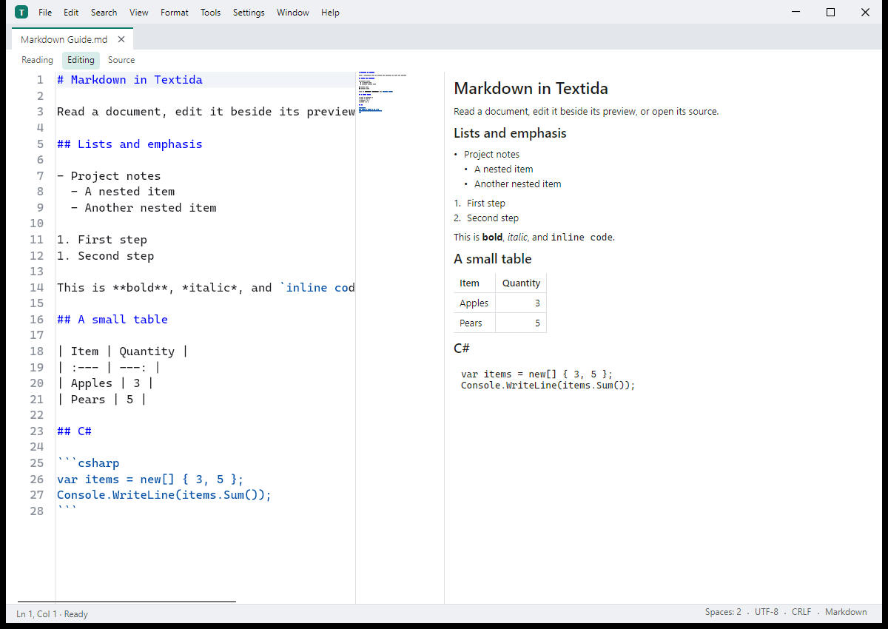

# Textida

[](https://github.com/nks-hub/textida/actions/workflows/release.yml)
[](https://github.com/nks-hub/textida/releases)
[](https://dotnet.microsoft.com/)
[](#voraussetzungen)
[](LICENSE)

> Texteditor für Windows, macOS und Linux. Er liest Dokumente seitenweise und öffnet so auch Dateien, die größer als der Arbeitsspeicher sind. Geschrieben in C# / .NET 10 mit Avalonia 12. Vorabversionen liegen auf der Seite [Releases](https://github.com/nks-hub/textida/releases).

**Sprachen:** [English](README.md) · [Čeština](README.cs.md) · [Slovenčina](README.sk.md) · Deutsch



[Produktseite und Screenshots](https://nks-hub.cz/reference/repo-textida)

Der Editor ist ein neues Programm nach dem Vorbild von PSPad. Er verwendet keinen Code, keine Daten und keine Ressourcen von PSPad.

## Funktionen

- 📄 **Seitenweise Dokumente** - liest nur die sichtbaren Bereiche von der Festplatte und hält Änderungen getrennt, mit Rückgängig und Speichern, das unveränderte Bytes erhält.
- 🔍 **Suche und Navigation** - Suche nach Text und regulären Ausdrücken, die sich abbrechen lässt, und Sprung zu einer Zeile oder einem Byte-Offset.
- 🔤 **Text und Hex** - Erkennung der Kodierung, Umwandlung in eine gewählte Kodierung, Textbearbeitung und eine Hex-Ansicht desselben Dokuments.
- 📝 **Markdown** - Lese-, Bearbeitungs- und Quelltextmodus; die Leseansicht legt nur sichtbare Blöcke an, setzt nach GitHub-Typografie, wählt über mehrere Blöcke aus und hat ein andockbares Überschriftenpanel.
- 🎨 **Farbschemata** - zehn Editor-Schemata, Farbe, Fett und Kursiv je Tokenart, Import von TextMate- und VS-Code-Schemata.
- 🗂️ **Großes JSON** - eine formatierte Ansicht, die die Datei blockweise im Hintergrund liest und Werte direkt bearbeitet.
- 🌿 **Git** - Commit-Panel mit Kästchen je Änderung, Pull, der zuerst abruft, und Zahl ein- und ausgehender Commits in der Statusleiste.
- 🧩 **Mitgelieferte Werkzeuge** - eigene Plugin-Prozesse für Formatierung, Textstatistik, Hashes und Sprachwerkzeuge, dazu ein MCP-Server.
- 📦 **Desktop-Pakete** - Installer und portables ZIP für Windows, DMG und ZIP für macOS sowie Pakete für Linux. Veröffentlichte NativeAOT-Builds bringen ihre Laufzeit mit.

## Voraussetzungen

- Windows 10 22H2 oder neuer (x64) oder macOS 14 oder neuer (Apple Silicon und Intel)
- Linux als Vorschau: Debian 12 oder neuer oder Ubuntu 22.04 oder neuer, auf x64 oder ARM64
- .NET SDK 10.0.403 (festgelegt in `global.json`) zum Bauen aus dem Quellcode; heruntergeladene NativeAOT-Pakete brauchen keine installierte .NET-Laufzeit
- [ripgrep](https://github.com/BurntSushi/ripgrep) nur für den Benchmark, der die Suche vergleicht

## Installation

Vorabversionen liegen auf der Seite [Releases](https://github.com/nks-hub/textida/releases). Sie sind noch nicht mit einem Herausgeberzertifikat signiert, deshalb warnen Windows SmartScreen und macOS Gatekeeper beim ersten Start.

- **Windows:** `TextidaSetup-<version>-win-x64.exe` installiert für den aktuellen Benutzer ohne Administratorrechte; das ZIP ist die portable Version.
- **macOS:** `Textida-<version>-osx-arm64.dmg` (Apple Silicon) oder `-osx-x64.dmg` (Intel). Ziehen Sie Textida in den Ordner Programme und öffnen Sie es beim ersten Mal per Rechtsklick und Öffnen.
- **Linux (Vorschau):** `textida_<version>_amd64.deb` für x64 oder `textida_<version>_arm64.deb` für ARM64. Das passende tar-Archiv `linux-x64` oder `linux-arm64` enthält `install.sh`, das nach `~/.local` installiert und OpenSSL 3 und ICU aus der Distribution braucht.

### Debian und Ubuntu (apt)

Die Release-Pakete stehen auch im apt-Repository von NKS Hub, sodass `apt upgrade` neue Versionen bringt. Das Repository enthält Pakete für x64 (`amd64`) und ARM64 (`arm64`):

```bash
curl -fsSL https://repo.nks-hub.cz/public-key.gpg | sudo gpg --dearmor -o /usr/share/keyrings/nks-dev.gpg

sudo tee /etc/apt/sources.list.d/textida.sources > /dev/null <<'EOF'
Types: deb
URIs: https://repo.nks-hub.cz/textida/
Suites: stable
Components: main
Architectures: amd64 arm64
Signed-By: /usr/share/keyrings/nks-dev.gpg
EOF

sudo apt update
sudo apt install textida
```

Die Metadaten des Repositorys signiert `NKS Dev <dev@nks-hub.cz>`. `sudo apt remove textida` deinstalliert das Paket; die Einstellungen unter `~/.config` bleiben erhalten.

Aus dem Quellcode bauen:

```bash
git clone https://github.com/nks-hub/textida.git
cd textida
dotnet build
dotnet test --filter "Category!=Perf"
```

Die `Perf`-Tests messen Zeiten und brauchen die Release-Konfiguration, die unter [Entwicklung](#entwicklung) beschrieben ist.

## Verwendung

Starten Sie unter Windows `Textida.exe`, öffnen Sie unter macOS Textida aus dem Ordner Programme und starten Sie unter Linux `textida`. Eine Datei öffnen Sie über das Menü, indem Sie sie ins Fenster ziehen, oder mit ihrem Pfad auf der Befehlszeile. Markdown-Dokumente haben einen Lese-, Bearbeitungs- und Quelltextmodus.

### Benchmarks

Erzeugen Sie den Benchmark-Korpus und starten Sie ein Szenario:

```bash
dotnet run -c Release --project bench/NksHub.Textida.Bench -- corpus --corpus ./bench-data/corpus --results ./bench-data/results
dotnet run -c Release --project bench/NksHub.Textida.Bench -- a3 text-1GiB.log --corpus ./bench-data/corpus --results ./bench-data/results
```

Der Korpus mit den Dateien von 10 GiB und 50 GiB braucht etwa 130 GB freien Speicherplatz. `bench/run-mac.sh` startet das Größenprofil für macOS.

## Entwicklung

```bash
dotnet build NksHub.Textida.sln
dotnet test NksHub.Textida.sln --filter "Category!=Perf"
DOTNET_TieredCompilation=0 dotnet test tests/NksHub.Textida.App.Tests -c Release --filter "Category=Perf"
```

Mit `Perf` markierte Tests laufen in Release mit abgeschalteter mehrstufiger Kompilierung und immer nur eine Testassembly auf einmal (p95 beim Tippen 33 ms). In PowerShell setzen Sie `$env:DOTNET_TieredCompilation = "0"` und lassen das Bash-Präfix mit der Zuweisung weg. `Large`-Tests verwenden eine Sparse-Datei mit 4,5 GiB und dauern etwa eine Minute.

Eine NativeAOT-Distribution entsteht mit einem Befehl. Sie enthält den Editor, die eingebauten Plugins in `plugins/<name>/` und `textida-mcp` in `mcp/`, ohne Symbole (`-p:PublishSymbols=true` behält die `.pdb`-Dateien). Die AOT-Prüfung kontrolliert die Dateistruktur und startet jedes Programm:

```bash
dotnet publish src/NksHub.Textida.App -c Release -r win-x64 -o ./dist
dotnet publish tools/NksHub.Textida.AotCheck -c Release -r win-x64 -o ./aotcheck
./aotcheck/NksHub.Textida.AotCheck --publish ./dist
```

Aus dieser Ausgabe entsteht das Windows-Paket in zwei Formen.

- `Textida-<version>-win-x64.zip` ist die portable Form (entpacken, `Textida.exe` starten). `Install.cmd` darin startet `Setup.ps1`, einen Skript-Installer für einen Benutzer ohne Optionen.
- `TextidaSetup-<version>-win-x64.exe` ist der Installer mit Optionen: eine NativeAOT-Datei, die das ZIP und die nativen Bibliotheken ihres Fensters enthält. Er hat vier Sprachen (zuerst die Sprache von Windows, umschaltbar), zeigt die MIT-Lizenz und fragt nach dem Installationsordner, einer Verknüpfung im Startmenü, einer Verknüpfung auf dem Desktop, dem Eintrag „Mit Textida öffnen“ im Explorer-Menü, den Dateitypen unter Öffnen mit und danach, ob Textida am Ende starten soll. Er braucht keine Administratorrechte und lässt PSPad unberührt.

Der Installer installiert standardmäßig nach `%LOCALAPPDATA%\Programs\Textida` und legt dort eine Kopie von sich als Deinstallationsprogramm ab (`TextidaSetup.exe --uninstall`, der Befehl hinter Apps & Features). Das Deinstallationsprogramm entfernt die Dateien, Verknüpfungen, den Menüeintrag, die Dateizuordnungen und den Eintrag in Apps & Features. Die Einstellungen in `%APPDATA%\Textida` bleiben, wenn „Einstellungen ebenfalls löschen“ nicht angehakt ist. Läuft der Installer über einer vorhandenen Installation, aktualisiert er sie, behält die vorige Version in `Textida.previous` und zeigt die Optionen im aktuellen Zustand. Für Skripte gibt es einen stillen Modus:

```bat
TextidaSetup.exe --silent --dir "D:\Apps\Textida" --no-menu --desktop --assoc .txt,.md --lang en
TextidaSetup.exe --uninstall --silent --delete-settings
TextidaSetup.exe --help
```

Der Exit-Code ist 0 bei Erfolg, 1 bei einem Fehler (der Grund wird ausgegeben) und 2 bei einer falschen Befehlszeile. Der Build führt die AOT-Prüfung über die Publish-Ausgabe, das ZIP und den Installer aus und gibt den SHA-256 beider Dateien aus:

```bash
dotnet run tools/BuildWindowsPackage.cs -- --version <version> --output ./artifacts
```

Dieselben Schalter stehen in den Einstellungen unter Systemintegration (durchsuchbar): der Eintrag im Explorer-Menü, die Dateitypen, die Verknüpfungen im Startmenü und auf dem Desktop und eine Schaltfläche, die die Seite für Standard-Apps von Windows öffnet, wo das Standardprogramm eines Dateityps gewählt wird. Die Schalter lesen die Registry und schreiben sofort hinein; das Menü Extras hat dieselben Befehle für den Menüeintrag und die Zuordnungen. Alles schreibt das Programm selbst unter `HKCU\Software\Classes`.

Das macOS-Paket (`Textida.app` als ZIP und DMG, eines pro Architektur, ad hoc signiert und nicht notarisiert) wird auf einem Mac gebaut, die Linux-Pakete (ein `.deb` und ein `.tar.gz` mit `install.sh` und `uninstall.sh`) unter Linux:

```bash
dotnet run tools/BuildMacPackage.cs -- --version <version> --rid osx-arm64 --output ./artifacts
dotnet run tools/BuildLinuxPackage.cs -- --version <version> --output ./artifacts
dotnet run tools/BuildLinuxPackage.cs -- --version <version> --rid linux-arm64 --output ./artifacts
```

Ein Push eines `v*`-Tags startet [`.github/workflows/release.yml`](.github/workflows/release.yml). Der Workflow baut die Pakete für Windows, macOS und Linux, startet jedes Programm einmal mit `--smoke` und hängt sie zusammen mit `SHA256SUMS.txt` und dem signierten `feed.json` an einen Release-Entwurf. Jeder Plattform-Build prüft außerdem das Beispiel-Plugin und kontrolliert, dass die Pakete keine Dateien von PSPad enthalten. Der Entwurf entsteht nur, wenn die Clean-Room-Prüfung und alle fünf Plattform-Builds bestehen. Veröffentlichen Sie den Entwurf nach der Prüfung des Installers und committen Sie dann sein `feed.json` in den Branch `update-feed`. Der signierte Feed gilt 90 Tage; erscheint bis dahin kein neues Release, starten Sie [`resign-feed.yml`](.github/workflows/resign-feed.yml) von Hand und committen Sie das erzeugte `feed.json` auf dieselbe Weise. Linux bleibt eine Vorschau; die automatischen GUI-Prüfungen laufen dort unter Xvfb.

Prüfen Sie vor der Veröffentlichung die tatsächlichen Pakete für Windows x64, macOS arm64 und x64 sowie Linux x64 und arm64. Prüfen Sie nach der Veröffentlichung den öffentlichen Download und den signierten Feed und aktualisieren Sie dann die [Produktseite von NKS Hub](https://nks-hub.cz/reference/repo-textida), diese README und die Beschreibung des Repositorys mit derselben geprüften Version und denselben Angaben zu den Plattformen. Produkt-Screenshots müssen aus der laufenden Anwendung mit Beispieldokumenten stammen.

Textida sucht einige Sekunden nach dem Start und danach einmal täglich nach Updates und auch, wenn Sie Hilfe, Nach Updates suchen wählen; `updates.checkOnStart` auf false schaltet die automatische Suche aus. Eine neuere Version zeigt ein Zeichen in der Statusleiste. Die Suche ist ein GET auf den [signierten Feed](https://raw.githubusercontent.com/nks-hub/textida/update-feed/feed.json), der auch Vorabversionen enthält. Jedes Paket muss zum signierten SHA-256 und zur Größe passen. Unter Windows tauscht der Installer die Ordner, nachdem Textida geschlossen ist; macOS und entpackte Linux-Installationen tauschen die Verzeichnisse atomar. Die alte Version bleibt für ein Zurücksetzen in `Textida.previous`. Linux-Installationen, die apt verwaltet, werden über apt aktualisiert. macOS nimmt nur signierte und notarisierte Bundles an, deshalb müssen die aktuellen ad hoc signierten Vorabversionen von Hand installiert werden.

Projekte und Namespaces tragen das Präfix `NksHub.Textida`. Die Aufgabenliste für alle Etappen steht in [TODO.md](TODO.md) (auf Tschechisch).

## Mitwirken

1. Forken Sie das Repository
2. Legen Sie einen Branch an (`git checkout -b feature/my-change`)
3. Committen Sie Ihre Änderungen (`git commit -m "feat: add my change"`)
4. Pushen Sie den Branch (`git push origin feature/my-change`)
5. Öffnen Sie einen Pull Request

## Support

- 📧 **E-Mail:** dev@nks-hub.cz
- 🐛 **Fehlermeldungen:** [GitHub Issues](https://github.com/nks-hub/textida/issues)

## Lizenz

MIT-Lizenz – Details in [LICENSE](LICENSE).

---

<p align="center">Made with ❤️ by <a href="https://github.com/nks-hub">NKS Hub</a></p>
