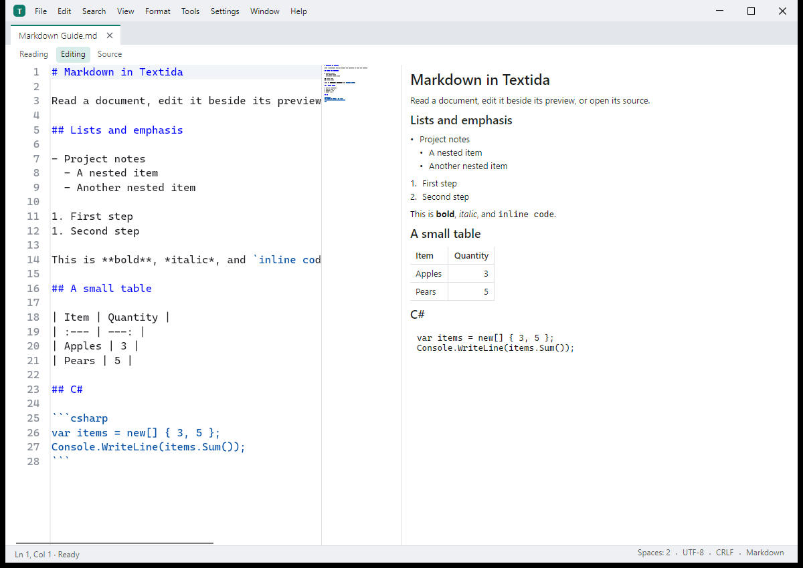

# Textida

[](https://github.com/nks-hub/textida/actions/workflows/release.yml)
[](https://github.com/nks-hub/textida/releases)
[](https://dotnet.microsoft.com/)
[](#requirements)
[](LICENSE)

> Text editor for Windows, macOS and Linux with a paged document core for files larger than RAM. Built with C# / .NET 10 and Avalonia 12. Preview builds are on the [Releases](https://github.com/nks-hub/textida/releases) page.



[Product page and screenshots](https://nks-hub.cz/reference/repo-textida)

The editor is a new program inspired by PSPad; it does not use PSPad code, data or resources.

## Features

- 📄 **Paged documents** - reads visible ranges from disk and keeps edits separately, with undo and byte-preserving saves.
- 🔍 **Search and navigation** - literal and regular-expression search, cancellation, line and byte-offset navigation.
- 🔤 **Text and hex** - encoding detection, explicit encoding conversion, text editing and a hex view over the same document.
- 📝 **Markdown** - reading, editing and source modes, native preview, table editing and a generated table of contents.
- 🧩 **Bundled tools** - separate plugin processes for formatting, text statistics, hashes and language tools, plus an MCP server.
- 📦 **Desktop packages** - Windows installer and portable ZIP, macOS DMG and ZIP, and Linux packages. Published NativeAOT builds include their runtime.

## Requirements

- Windows 10 22H2 or newer (x64), or macOS 14 or newer (Apple silicon and Intel)
- Linux preview: Debian 12 or newer, or Ubuntu 22.04 or newer, on x64 or ARM64
- .NET SDK 10.0.402 (pinned in `global.json`) to build from source; downloaded NativeAOT packages do not require an installed .NET runtime
- [ripgrep](https://github.com/BurntSushi/ripgrep) only for the search comparison benchmark

## Installation

Preview builds are on the [Releases](https://github.com/nks-hub/textida/releases) page. They are not signed with a publisher certificate yet, so Windows SmartScreen and macOS Gatekeeper warn on the first start.

- **Windows:** `TextidaSetup-<version>-win-x64.exe` installs for the current user without administrator rights; the ZIP is the portable version.
- **macOS:** `Textida-<version>-osx-arm64.dmg` (Apple silicon) or `-osx-x64.dmg` (Intel). Drag Textida to Applications, then right-click it and choose Open the first time.
- **Linux (preview):** `textida_<version>_amd64.deb` for x64 or `textida_<version>_arm64.deb` for ARM64. The matching `linux-x64` or `linux-arm64` tar archive includes `install.sh`, which installs into `~/.local` and needs OpenSSL 3 and ICU from the distribution.

### Debian and Ubuntu (apt)

Release packages are also published in the NKS Hub apt repository, so `apt upgrade` brings new versions. The repository supports x64 (`amd64`) and ARM64 (`arm64`):

```bash
curl -fsSL https://repo.nks-hub.cz/public-key.gpg | sudo gpg --dearmor -o /usr/share/keyrings/nks-dev.gpg

sudo tee /etc/apt/sources.list.d/textida.sources > /dev/null <<'EOF'
Types: deb
URIs: https://repo.nks-hub.cz/textida/
Suites: stable
Components: main
Architectures: amd64 arm64
Signed-By: /usr/share/keyrings/nks-dev.gpg
EOF

sudo apt update
sudo apt install textida
```

The repository metadata is signed by `NKS Dev <dev@nks-hub.cz>`. `sudo apt remove textida` uninstalls it; the settings under `~/.config` stay.

Build from source:

```bash
git clone https://github.com/nks-hub/textida.git
cd textida
dotnet build
dotnet test
```

## Usage

Run `Textida.exe` on Windows, open Textida from Applications on macOS, or run `textida` on Linux. Open a file through the menu, drag it into the window, or pass its path on the command line. Markdown documents have reading, editing and source modes.

### Benchmarks

Generate the benchmark corpus and run a scenario:

```bash
dotnet run -c Release --project bench/NksHub.Textida.Bench -- corpus --corpus ./bench-data/corpus --results ./bench-data/results
dotnet run -c Release --project bench/NksHub.Textida.Bench -- a3 text-1GiB.log --corpus ./bench-data/corpus --results ./bench-data/results
```

The corpus with the 10 GiB and 50 GiB files needs about 130 GB of free disk space. `bench/run-mac.sh` runs the macOS size profile.

## Development

```bash
dotnet build NksHub.Textida.sln
dotnet test NksHub.Textida.sln --filter "Category!=Perf"
DOTNET_TieredCompilation=0 dotnet test tests/NksHub.Textida.App.Tests -c Release --filter "Category=Perf"
```

Tests marked `Perf` use Release with tiered compilation disabled and run one test assembly at a time (typing p95 33 ms). In PowerShell, set `$env:DOTNET_TieredCompilation = "0"` and omit the Bash assignment prefix. `Large` tests use a sparse 4.5 GiB file and take about a minute.

A NativeAOT distribution comes from one command; it holds the editor, the built-in plugins in `plugins/<name>/` and `textida-mcp` in `mcp/`, without symbols (`-p:PublishSymbols=true` keeps the `.pdb` files). The AOT check verifies the layout and starts every program:

```bash
dotnet publish src/NksHub.Textida.App -c Release -r win-x64 -o ./dist
dotnet publish tools/NksHub.Textida.AotCheck -c Release -r win-x64 -o ./aotcheck
./aotcheck/NksHub.Textida.AotCheck --publish ./dist
```

The Windows package is built from that output in two forms.

- `Textida-<version>-win-x64.zip` is the portable form (unpack, start `Textida.exe`). `Install.cmd` in it runs `Setup.ps1`, a per-user script installer without options.
- `TextidaSetup-<version>-win-x64.exe` is the installer with options: one NativeAOT file that carries the ZIP and the native libraries of its window. It has four languages (the language of Windows first, switchable), shows the MIT licence, and asks for the install folder, a Start menu shortcut, a desktop shortcut, the Explorer menu entry "Open with Textida", the file types offered under Open with, and whether to start Textida when it is done. It needs no administrator rights and does not touch PSPad.

The setup installs to `%LOCALAPPDATA%\Programs\Textida` by default and keeps a copy of itself there as the uninstaller (`TextidaSetup.exe --uninstall`, the command behind Apps & features). The uninstaller removes the files, shortcuts, menu entry, associations and the Apps & features entry, and keeps the settings in `%APPDATA%\Textida` unless "Delete my settings as well" is ticked. Running the setup over an installed Textida updates it, keeps the previous version in `Textida.previous` and starts with the options as they are now. For scripts there is a silent mode:

```bat
TextidaSetup.exe --silent --dir "D:\Apps\Textida" --no-menu --desktop --assoc .txt,.md --lang en
TextidaSetup.exe --uninstall --silent --delete-settings
TextidaSetup.exe --help
```

The exit code is 0 when it worked, 1 when it failed (the reason is printed) and 2 for a wrong command line. The build runs the AOT check on the publish output, on the ZIP and on the setup, and prints the SHA-256 of both files:

```bash
dotnet run tools/BuildWindowsPackage.cs -- --version <version> --output ./artifacts
```

The same switches are in the settings under System integration (searchable): the Explorer menu entry, the file types, the Start menu and desktop shortcuts, and a button that opens the default apps page of Windows, where the default program of a file type is chosen. They read the registry and write it at once; the Tools menu has the same commands for the menu entry and the associations. All of it is written by the program itself under `HKCU\Software\Classes`.

The macOS package (`Textida.app` as a ZIP and a DMG, one per architecture, signed ad hoc and not notarized) is built on a Mac, and the Linux packages (a `.deb` and a `.tar.gz` with `install.sh` and `uninstall.sh`) on Linux:

```bash
dotnet run tools/BuildMacPackage.cs -- --version <version> --rid osx-arm64 --output ./artifacts
dotnet run tools/BuildLinuxPackage.cs -- --version <version> --output ./artifacts
dotnet run tools/BuildLinuxPackage.cs -- --version <version> --rid linux-arm64 --output ./artifacts
```

Pushing a `v*` tag runs [`.github/workflows/release.yml`](.github/workflows/release.yml). It builds the Windows, macOS and Linux packages, starts each program once with `--smoke`, and attaches them with `SHA256SUMS.txt` and the signed `feed.json` to a draft release. All five platform builds must pass. Publish the draft after checking the installer, then commit its `feed.json` to the `update-feed` branch. Linux remains a preview; its automated GUI checks run under Xvfb.

Before publishing, verify the actual packages for Windows x64, macOS arm64 and x64, and Linux x64 and arm64. After publishing, check the public download and signed feed, then update the [NKS Hub product page](https://nks-hub.cz/reference/repo-textida), this README and the repository description with the same verified version and platform information. Product screenshots must come from the running application with sample documents.

Updates are checked only when you choose Help, Check for Updates, or at start if `updates.checkOnStart` is on (off by default). The check is one GET of the [signed feed](https://raw.githubusercontent.com/nks-hub/textida/update-feed/feed.json), which also covers preview releases. Each package must match the signed SHA-256 and size. Windows uses the installer to switch folders after Textida closes; macOS and unpacked Linux installations use an atomic directory exchange. The old version stays in `Textida.previous` for rollback. Linux installations managed by apt update through apt. macOS accepts only signed and notarized bundles, so the current ad-hoc signed previews require manual installation.

Projects and namespaces use the `NksHub.Textida` prefix. The task list for all stages is in [TODO.md](TODO.md) (Czech).

## Contributing

1. Fork the repository
2. Create a feature branch (`git checkout -b feature/my-change`)
3. Commit your changes (`git commit -m "feat: add my change"`)
4. Push to the branch (`git push origin feature/my-change`)
5. Open a Pull Request

## Support

- 📧 **Email:** dev@nks-hub.cz
- 🐛 **Bug reports:** [GitHub Issues](https://github.com/nks-hub/textida/issues)

## License

MIT License — see [LICENSE](LICENSE) for details.

---

<p align="center">Made with ❤️ by <a href="https://github.com/nks-hub">NKS Hub</a></p>
