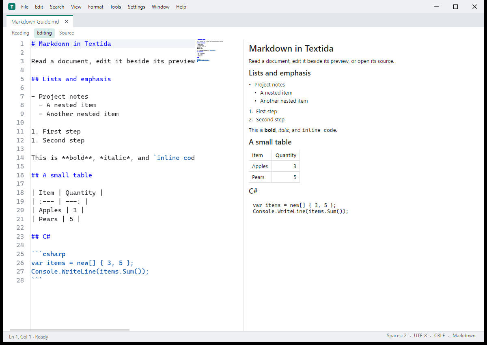

# Textida

[](https://github.com/nks-hub/textida/actions/workflows/release.yml)
[](https://github.com/nks-hub/textida/releases)
[](https://dotnet.microsoft.com/)
[](#požiadavky)
[](LICENSE)

> Textový editor pre Windows, macOS a Linux. Dokument číta po stránkach, takže otvorí aj súbor väčší ako pamäť RAM. Je napísaný v C# / .NET 10 a Avalonia 12. Testovacie zostavenia sú na stránke [Releases](https://github.com/nks-hub/textida/releases).

**Jazyky:** [English](README.md) · [Čeština](README.cs.md) · Slovenčina · [Deutsch](README.de.md)



[Stránka produktu a snímky obrazovky](https://nks-hub.cz/reference/repo-textida)

Editor je nový program inšpirovaný PSPadom. Nepoužíva kód, dáta ani zdroje PSPadu.

## Funkcie

- 📄 **Dokumenty po stránkach** - z disku číta len viditeľné úseky a úpravy drží zvlášť, s funkciou späť a ukladaním, ktoré nezmení nedotknuté bajty.
- 🔍 **Hľadanie a navigácia** - hľadanie obyčajného textu aj regulárnych výrazov, ktoré sa dá prerušiť, a skok na riadok alebo na pozíciu v bajtoch.
- 🔤 **Text a hex** - rozpoznanie kódovania, prevod do zvoleného kódovania, úpravy textu a hexadecimálny pohľad na ten istý dokument.
- 📝 **Markdown** - režim čítania, úprav a zdroja, vlastný náhľad, úpravy tabuliek a vygenerovaný obsah.
- 🧩 **Pribalené nástroje** - samostatné procesy pluginov na formátovanie, štatistiku textu, hashe a jazykové nástroje a k tomu server MCP.
- 📦 **Balíky pre desktop** - inštalátor a prenosný ZIP pre Windows, DMG a ZIP pre macOS a balíky pre Linux. Vydané zostavenia NativeAOT majú runtime v sebe.

## Požiadavky

- Windows 10 22H2 alebo novší (x64), alebo macOS 14 alebo novší (Apple silicon aj Intel)
- Linux (skúšobne): Debian 12 alebo novší, alebo Ubuntu 22.04 alebo novší, na x64 alebo ARM64
- .NET SDK 10.0.402 (pevne v `global.json`) na zostavenie zo zdrojov; stiahnuté balíky NativeAOT nainštalovaný runtime .NET nepotrebujú
- [ripgrep](https://github.com/BurntSushi/ripgrep) len na porovnávacie meranie hľadania

## Inštalácia

Testovacie zostavenia sú na stránke [Releases](https://github.com/nks-hub/textida/releases). Zatiaľ nie sú podpísané certifikátom vydavateľa, takže Windows SmartScreen a macOS Gatekeeper pri prvom spustení varujú.

- **Windows:** `TextidaSetup-<version>-win-x64.exe` inštaluje pre aktuálneho používateľa bez práv správcu; ZIP je prenosná verzia.
- **macOS:** `Textida-<version>-osx-arm64.dmg` (Apple silicon) alebo `-osx-x64.dmg` (Intel). Presuňte Textidu do priečinka Aplikácie a prvýkrát ju otvorte pravým tlačidlom a voľbou Otvoriť.
- **Linux (skúšobne):** `textida_<version>_amd64.deb` pre x64 alebo `textida_<version>_arm64.deb` pre ARM64. Zodpovedajúci archív tar `linux-x64` alebo `linux-arm64` obsahuje `install.sh`, ktorý inštaluje do `~/.local` a potrebuje OpenSSL 3 a ICU z distribúcie.

### Debian a Ubuntu (apt)

Balíky z vydaní sú aj v apt repozitári NKS Hub, takže nové verzie prinesie `apt upgrade`. Repozitár má balíky pre x64 (`amd64`) a ARM64 (`arm64`):

```bash
curl -fsSL https://repo.nks-hub.cz/public-key.gpg | sudo gpg --dearmor -o /usr/share/keyrings/nks-dev.gpg

sudo tee /etc/apt/sources.list.d/textida.sources > /dev/null <<'EOF'
Types: deb
URIs: https://repo.nks-hub.cz/textida/
Suites: stable
Components: main
Architectures: amd64 arm64
Signed-By: /usr/share/keyrings/nks-dev.gpg
EOF

sudo apt update
sudo apt install textida
```

Metadáta repozitára podpisuje `NKS Dev <dev@nks-hub.cz>`. Odinštaluje sa príkazom `sudo apt remove textida`; nastavenia v `~/.config` zostanú.

Zostavenie zo zdrojov:

```bash
git clone https://github.com/nks-hub/textida.git
cd textida
dotnet build
dotnet test --filter "Category!=Perf"
```

Testy `Perf` merajú čas a potrebujú zostavenie Release opísané v časti [Vývoj](#vývoj).

## Použitie

Na Windows spustite `Textida.exe`, na macOS otvorte Textidu z priečinka Aplikácie a na Linuxe spustite `textida`. Súbor otvorte z menu, presunutím do okna alebo cestou na príkazovom riadku. Dokumenty Markdown majú režim čítania, úprav a zdroja.

### Meranie výkonu

Vygenerujte sadu testovacích súborov a spustite scenár:

```bash
dotnet run -c Release --project bench/NksHub.Textida.Bench -- corpus --corpus ./bench-data/corpus --results ./bench-data/results
dotnet run -c Release --project bench/NksHub.Textida.Bench -- a3 text-1GiB.log --corpus ./bench-data/corpus --results ./bench-data/results
```

Sada so súbormi s veľkosťou 10 GiB a 50 GiB zaberie asi 130 GB voľného miesta na disku. `bench/run-mac.sh` spustí veľkostný profil pre macOS.

## Vývoj

```bash
dotnet build NksHub.Textida.sln
dotnet test NksHub.Textida.sln --filter "Category!=Perf"
DOTNET_TieredCompilation=0 dotnet test tests/NksHub.Textida.App.Tests -c Release --filter "Category=Perf"
```

Testy označené `Perf` bežia v Release s vypnutou vrstvenou kompiláciou a vždy len jedno testovacie zostavenie naraz (p95 písania 33 ms). V PowerShelli nastavte `$env:DOTNET_TieredCompilation = "0"` a predponu s priradením z Bashu vynechajte. Testy `Large` pracujú s riedkym súborom s veľkosťou 4,5 GiB a trvajú asi minútu.

Distribúciu NativeAOT vytvorí jeden príkaz. Obsahuje editor, vstavané pluginy v `plugins/<name>/` a `textida-mcp` v `mcp/`, bez symbolov (`-p:PublishSymbols=true` súbory `.pdb` ponechá). Kontrola AOT overí rozloženie súborov a spustí každý program:

```bash
dotnet publish src/NksHub.Textida.App -c Release -r win-x64 -o ./dist
dotnet publish tools/NksHub.Textida.AotCheck -c Release -r win-x64 -o ./aotcheck
./aotcheck/NksHub.Textida.AotCheck --publish ./dist
```

Z tohto výstupu vzniká balík pre Windows v dvoch podobách.

- `Textida-<version>-win-x64.zip` je prenosná podoba (rozbaliť, spustiť `Textida.exe`). `Install.cmd` v ňom spustí `Setup.ps1`, skriptový inštalátor pre jedného používateľa bez volieb.
- `TextidaSetup-<version>-win-x64.exe` je inštalátor s voľbami: jeden súbor NativeAOT, ktorý nesie ZIP a natívne knižnice svojho okna. Vie štyri jazyky (najprv jazyk Windows, dá sa prepnúť), ukáže licenciu MIT a opýta sa na priečinok inštalácie, odkaz v ponuke Štart, odkaz na ploche, položku „Otvoriť v Textide“ v menu Prieskumníka, typy súborov ponúkané v Otvoriť pomocou a na to, či má Textidu na konci spustiť. Nepotrebuje práva správcu a PSPadu sa nedotkne.

Inštalátor v predvolenom stave inštaluje do `%LOCALAPPDATA%\Programs\Textida` a nechá tam svoju kópiu ako odinštalátor (`TextidaSetup.exe --uninstall`, príkaz, ktorý spúšťa Aplikácie a funkcie). Odinštalátor odstráni súbory, odkazy, položku menu, priradenia a záznam v Aplikácie a funkcie. Nastavenia v `%APPDATA%\Textida` ponechá, ak nie je začiarknuté „Zmazať aj nastavenia“. Inštalátor spustený nad nainštalovanou Textidou ju aktualizuje, predchádzajúcu verziu uloží do `Textida.previous` a ponúkne voľby v aktuálnom stave. Pre skripty má tichý režim:

```bat
TextidaSetup.exe --silent --dir "D:\Apps\Textida" --no-menu --desktop --assoc .txt,.md --lang en
TextidaSetup.exe --uninstall --silent --delete-settings
TextidaSetup.exe --help
```

Návratový kód je 0 pri úspechu, 1 pri chybe (vypíše dôvod) a 2 pri chybnom príkazovom riadku. Zostavenie spustí kontrolu AOT nad výstupom publikácie, nad ZIPom aj nad inštalátorom a vypíše SHA-256 oboch súborov:

```bash
dotnet run tools/BuildWindowsPackage.cs -- --version <version> --output ./artifacts
```

Rovnaké prepínače sú v nastaveniach v časti Integrácia so systémom (dá sa vyhľadať): položka menu Prieskumníka, typy súborov, odkazy v ponuke Štart a na ploche a tlačidlo, ktoré otvorí stránku predvolených aplikácií vo Windows, kde sa volí predvolený program pre typ súboru. Prepínače čítajú register a zapisujú doň hneď; menu Nástroje má tie isté príkazy pre položku menu a priradenia. Všetko zapisuje program sám pod `HKCU\Software\Classes`.

Balík pre macOS (`Textida.app` ako ZIP a DMG, jeden pre každú architektúru, podpísaný ad hoc a bez notarizácie) sa zostavuje na Macu, balíky pre Linux (`.deb` a `.tar.gz` s `install.sh` a `uninstall.sh`) na Linuxe:

```bash
dotnet run tools/BuildMacPackage.cs -- --version <version> --rid osx-arm64 --output ./artifacts
dotnet run tools/BuildLinuxPackage.cs -- --version <version> --output ./artifacts
dotnet run tools/BuildLinuxPackage.cs -- --version <version> --rid linux-arm64 --output ./artifacts
```

Push tagu `v*` spustí [`.github/workflows/release.yml`](.github/workflows/release.yml). Workflow zostaví balíky pre Windows, macOS a Linux, každý program raz spustí s `--smoke` a priloží ich spolu so `SHA256SUMS.txt` a podpísaným `feed.json` ku konceptu vydania. Každé zostavenie pre platformu navyše overí ukážkový plugin a skontroluje, že balíky neobsahujú súbory PSPadu. Koncept vznikne, len keď prejde kontrola čistého pôvodu kódu a všetkých päť zostavení pre platformy. Koncept zverejnite po kontrole inštalátora a jeho `feed.json` potom commitnite do vetvy `update-feed`. Podpísaný feed platí 90 dní. Keď dovtedy nevyjde nové vydanie, spustite ručne [`resign-feed.yml`](.github/workflows/resign-feed.yml) a vytvorený `feed.json` commitnite rovnako. Linux zostáva skúšobný; jeho automatické kontroly GUI bežia pod Xvfb.

Pred zverejnením overte skutočné balíky pre Windows x64, macOS arm64 a x64 a Linux x64 a arm64. Po zverejnení skontrolujte verejné stiahnutie a podpísaný feed a potom aktualizujte [stránku produktu NKS Hub](https://nks-hub.cz/reference/repo-textida), toto README a popis repozitára s rovnakou overenou verziou a rovnakými údajmi o platformách. Snímky obrazovky produktu musia pochádzať z bežiacej aplikácie s ukážkovými dokumentmi.

Textida hľadá aktualizácie niekoľko sekúnd po spustení a potom raz denne a tiež keď zvolíte Pomocník, Zistiť aktualizácie; nastavenie `updates.checkOnStart` na false automatické hľadanie vypne. Novšia verzia ukáže odznak v stavovom riadku. Hľadanie je jedna požiadavka GET na [podpísaný feed](https://raw.githubusercontent.com/nks-hub/textida/update-feed/feed.json), ktorý zahŕňa aj testovacie vydania. Každý balík musí sedieť s podpísaným SHA-256 a veľkosťou. Windows prepne priečinky inštalátorom po zatvorení Textidy; macOS a rozbalené inštalácie na Linuxe atomicky vymenia adresáre. Stará verzia zostane v `Textida.previous` na návrat späť. Inštalácie na Linuxe spravované cez apt sa aktualizujú cez apt. macOS prijme len podpísané balíky s notarizáciou, preto sa súčasné testovacie zostavenia podpísané ad hoc musia inštalovať ručne.

Projekty a menné priestory majú predponu `NksHub.Textida`. Zoznam úloh pre všetky etapy je v [TODO.md](TODO.md) (po česky).

## Prispievanie

1. Urobte fork repozitára
2. Vytvorte vetvu (`git checkout -b feature/my-change`)
3. Commitnite zmeny (`git commit -m "feat: add my change"`)
4. Pushnite vetvu (`git push origin feature/my-change`)
5. Otvorte Pull Request

## Podpora

- 📧 **E-mail:** dev@nks-hub.cz
- 🐛 **Hlásenie chýb:** [GitHub Issues](https://github.com/nks-hub/textida/issues)

## Licencia

Licencia MIT – podrobnosti v [LICENSE](LICENSE).

---

<p align="center">Made with ❤️ by <a href="https://github.com/nks-hub">NKS Hub</a></p>
